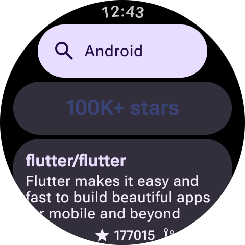

# Wear Paging Mediator

A Wear OS app for searching GitHub repositories. Built with Clean Architecture and [Compose for Wear OS](https://developer.android.com/training/wearables/compose), it uses [Paging 3](https://developer.android.com/topic/libraries/architecture/paging/v3-overview) with `RemoteMediator` for an offline-first experience.

## Features

- 🔍 **Search & history** — query GitHub repositories via voice or text input, or long-press the search button to reopen one of the last 20 queries
- 📄 **Paginated results** — infinite scrolling with star-band separators between cards
- 🏷️ **Repository details** — tap a card for the full description, exact stats, and clickable topics that start a new search, or long-press to open it in a browser
- 💾 **Offline support** — cached queries and results remain available without a network connection
- ⌚ **Wear OS native UI** — built for round displays with rotary scroll support

## Overview

1. **Splash screen** — the app icon on a black background before the main screen opens.
2. **Main screen** — the default `android` query with the search button and repository cards (name, summary, programming language, and abbreviated star/fork counts).
3. **Recent searches** — up to the last 20 queries with the moment each one was used; tapping an entry runs that search.
4. **Search input** — the Wear OS input panel for a typed or dictated query.
5. **Scrolled repository list** — paginated results divided by star-band separators.
6. **Repository details & topics** — the full description, exact star and fork counts, and topics that start a new search.

## Architecture

The project follows **Clean Architecture** across four Gradle modules with unidirectional data flow (**MVI**) in the presentation layer and an **offline-first Paging 3** pipeline in the data layer.

### Modules

- **`:app`** — Application setup, Hilt DI graph, and `MainActivity` entry point.
- **`:domain`** — Core models (`Repo`, `SearchQuery`, `RecentQuery`), `Repository` interface, and use cases (`GetReposFlowUseCase`, `GetRepoTopicsUseCase`, `GetRecentQueriesUseCase`).
- **`:data`** — `ReposRepository`, Retrofit `GitHubApi`, Room `GitHubDatabase`, mappers, and `ReposRemoteMediator`.
- **`:presentation`** — MVI state holder (`MainViewModel`), pure reducer (`MainReducer`), UI models/intents/effects, and Wear OS Compose screens.

### Offline-First Data & Paging Pipeline

- **Single source of truth** — Room's `PagingSource` emits cached results immediately when a query is opened, while `ReposRemoteMediator` fetches fresh pages from the [GitHub Search API](https://docs.github.com/en/rest/search/search#search-repositories) in the background.
- **Transactional caching** — Each page load atomically updates repositories, per-query result ordering (`SearchQueryResultEntity`), pagination keys (`RepoRemoteKeyEntity`), and repository-topic relations (`RepoTopicCrossRef`) in Room.
- **Bounded query cache** — Queries are normalized via `SearchQuery` and cached per query in Room. `RecentQueriesCache` keeps the results of the `RecentQuery.MAX_CACHED_QUERIES` (20) most recently *opened* queries and deletes the rows of the rest, together with the repositories and topics no other query references. A query is opened when its `Pager` is created, not when GitHub answers, so an offline opening counts.
- **Schema migrations** — Room exports the schema of every version to `data/schemas`; `GitHubDatabaseMigrationTest` runs the real migrations on those exported schemas and validates the result against the current one.

### Presentation (MVI + Wear Compose)

- **Unidirectional flow** — UI events are sent as `MainIntent`s to `MainViewModel`, processed by the pure `MainReducer` into a new `MainState` (the active query is persisted via `SavedStateHandle`) and one-off `MainEffect`s (e.g., refreshing results or opening a link).
- **Wear OS UI** — `TransformingLazyColumn` with star-band separators (`StarBand`), load states shown next to the items, and dialogs that read Room on demand: the repository details on a tap and the recent queries on a long press of the search button.
- **Query flow cache** — `MainViewModel` keeps an in-memory LRU of `MainViewModel.MAX_CACHED_QUERIES` (3) query flows, deliberately fewer than the number of queries Room retains (`RecentQuery.MAX_CACHED_QUERIES`, 20), so the active query is never evicted from the database. The flow itself is cached, not its window of pages: returning to a visited query collects it again from the cached start, so a stale deep window is never replayed, and `getReposFlow` is not called twice for a cached query.

## Requirements

* Android Studio (a version that supports required AGP)
* JDK 17 or newer
* [Android Gradle Plugin](https://developer.android.com/build/releases/about-agp) 9.5.2
* [Gradle](https://github.com/gradle/gradle) 9.9.2 (via `./gradlew`)
* `minSdk` 30 (Wear OS 3+), `compileSdk` 37.2, `targetSdk` 37

## Dependencies

* [Kotlin](https://github.com/JetBrains/kotlin) 2.4.21 with [KSP](https://github.com/google/ksp) 2.3.14
* [Jetpack Compose for Wear OS](https://developer.android.com/jetpack/androidx/releases/wear-compose) (Material 3 + Foundation) 1.7.2
* [Jetpack Compose](https://developer.android.com/jetpack/compose/bom) (BOM) 2026.11.01
* [Hilt](https://github.com/google/dagger) 2.60.1
* [Coroutines](https://github.com/Kotlin/kotlinx.coroutines) 1.11.0
* [Paging](https://developer.android.com/topic/libraries/architecture/paging/v3-overview) 3.5.3
* [Room](https://developer.android.com/topic/libraries/architecture/room) 2.8.5 (with Room Paging)
* [Retrofit](https://github.com/square/retrofit) 3.0.0 and OkHttp logging interceptor 5.5.1
* [Moshi](https://github.com/square/moshi) 1.15.2 (codegen via KSP)

Full list of versions: [`gradle/libs.versions.toml`](gradle/libs.versions.toml)

## Testing

* [JUnit](https://github.com/junit-team/junit4) 4.13.2
* AndroidX Test (JUnit ext, runner), Espresso
* Compose UI Test, Room Testing

Run unit tests:

    ./gradlew test

Run instrumented tests (requires a connected Wear OS device or emulator):

    ./gradlew connectedAndroidTest

## License

[MIT](LICENSE) © [alxiw](https://github.com/alxiw)
